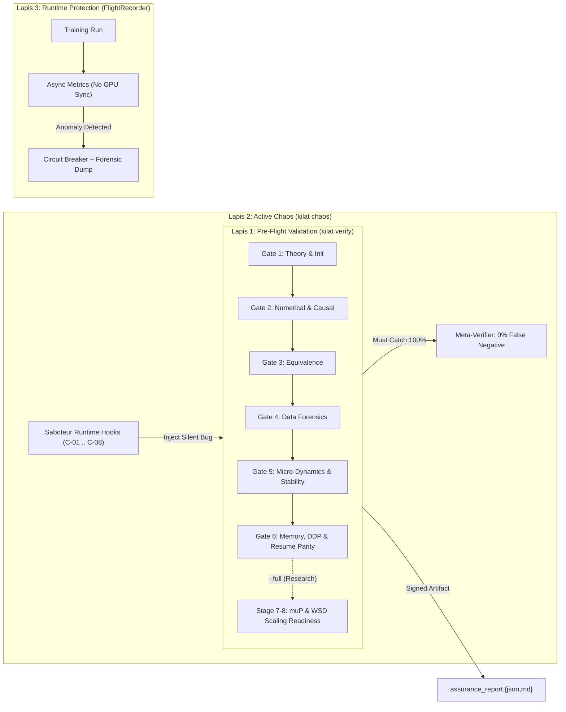

# 04 — Frontier Assurance, Active Chaos Engineering (`Saboteur`), & Runtime `FlightRecorder`

> **Tujuan Dokumen**: Mengubah validasi Kilat dari sekadar *unit testing* sintaksis menjadi **Research-Grade Pre-Training Validation & Chaos Assurance Pipeline** tiga lapis (Pre-Flight Gates, Active Fault Injection, dan Runtime Flight Telemetry) setara standar laboratorium frontier (Google DeepMind `Paxml`/`MaxText`, Meta `Lingua`, Microsoft/OpenAI $\mu\text{P}$, dan `DeepSeek-V3`).

---

## Arsitektur Tiga Lapis Assurance Kilat



---

## 1. Lapis 1 — Pre-Flight Validation Pipeline (`kilat verify`)

Setiap gerbang menghasilkan status `PASS` / `FAIL`, durasi milidetik, metrik terukur, dan kode kegagalan terstruktur (`AssuranceFailureCode`). Gerbang dieksekusi berurutan; kegagalan pada gerbang awal menghentikan pemborosan komputasi pada gerbang berikutnya (kecuali diberi flag `--keep-going`).

### Gate 1: Theoretical & Initialization Sanity (`gate1_theory.py`)
Memverifikasi kesesuaian persamaan teoretis dan distribusi inisialisasi pada langkah ke-0 sebelum satu pun langkah optimisasi dijalankan:
1. **Entropi Awal Tak-Bias ($\mathcal{L}_0 \approx \ln V$)**:
   - Pada input acak seragam $x \sim \mathcal{U}\{0, \dots, V-1\}$, *pure cross-entropy loss* awal wajib berada di dalam selang:
     $$\left|\mathcal{L}_{\text{CE}}(0) - \ln V\right| \le 0.15$$
   - Kegagalan menandakan skala `lm_head` terlalu besar (*overconfident logits*), salah bagi $\sqrt{d_k}$, atau bias tak-nol pada proyeksi akhir.
2. **Stabilitas Varians Aliran Residual Lintas Kedalaman**:
   - Ukur simpangan baku keluaran blok $\sigma_\ell = \operatorname{std}(h^{(\ell)})$ untuk $\ell = 1 \dots L$. Rasio pertumbuhan $\sigma_L / \sigma_1$ wajib berada pada batas sehat $[0.3, 3.0]$ berkat skala residual $\frac{\text{initializer\_range}}{\sqrt{2L}}$ (**M-06**).
3. **Audit Grup Weight Decay (`M-03`)**:
   - Pastikan **0 parameter** dengan `ndim < 2`, `log_lambda`, `RMSNorm`, `LayerNorm` (`q_a_norm`, `kv_a_norm`), atau `.bias` berada di dalam grup `weight_decay > 0`.
4. **Akuntansi Parameter Aktif vs Total & Estimasi VRAM**:
   - Hitung $\Phi_{\text{total}}$, $\Phi_{\text{active}}$ (memperhitungkan rasio *shared* + *routed* MoE), estimasi FLOPs/token ($6 \Phi_{\text{active}}$), dan estimasi jejak memori statis + aktivasi terhadap kapasitas perangkat.

### Gate 2: Numerical, Gradient, & Causal Integrity (`gate2_numerical.py`)
1. **Finite-Difference `torch.autograd.gradcheck` (`torch.float64`)**:
   - Uji `FlashDecayFunction` (termasuk rezim ekstrem $\lambda \in \{0.5, 0.9, 0.99999, 1.0 - 10^{-7}\}$), `RMSNorm`, `SwiGLU`, `KilatAttention`, `KilatAttentionRoPE`, dan `DeepSeekMoE` (untuk $K=1$ dan $K=2$) pada dimensi mikro ($B=2, S=6, D=16$) menggunakan `torch.autograd.gradcheck(..., eps=1e-6, atol=1e-5, rtol=1e-4)`:
     $$\max_{\theta} \frac{\left\|\nabla^{\text{analytic}}_\theta \mathcal{L} - \nabla^{\text{numeric}}_\theta \mathcal{L}\right\|_\infty}{\max\!\left(1, \left\|\nabla^{\text{numeric}}_\theta \mathcal{L}\right\|_\infty\right)} < 10^{-5}$$
2. **Uji Buta-Masa-Depan Kausal (*Causal Future-Blindness Perturbation / Jacobian*)**:
   - Jalankan `logits_a = model(x)` dalam mode evaluasi deterministik (`dropout=0`). Ubah seluruh token masa depan $x_{:, t^*+1 : S}$ secara drastis menjadi token acak lain $\tilde{x}$, lalu hitung `logits_b = model(x_tilde)`.
   - Invarian keras untuk seluruh posisi masa lalu dan kini $t \le t^*$ (uji untuk $t^* \in \{0, S//2, S-2\}$):
     $$\max_{t \le t^*} \left\|\text{logits}_a[:, t, :] - \text{logits}_b[:, t, :]\right\|_\infty \le \epsilon_{\text{dtype}} \quad (= 0.0 \text{ pada FP64 / CPU deterministik, } \le 10^{-6} \text{ pada FP32})$$
   - Selain itu, uji gradien kausal: hitung $\mathcal{L}_{\le t^*} = \text{logits}[:, t^*, :].sum()$, panggil `.backward()` terhadap embedding input $E$, dan pastikan $\|(\nabla_E \mathcal{L}_{\le t^*})[:, t^* + 1:, :]\|_\infty == 0.0$.
3. **Uji Isolasi Antar-Sampel (*Batch-Independence Test*)**:
   - Korupsi sampel indeks `1..B-1` di dalam *batch* dengan nilai ekstrem; keluaran `logits[0]` wajib tidak berubah ($\|\Delta \text{logits}[0]\|_\infty \le 10^{-6}$). Ini menangkap bug `view` vs `transpose` yang mencampur dimensi `B` dan `S` atau kebocoran status router MoE lintas sampel.
4. **Konektivitas Gradien 100% Parameter Aktif**:
   - Pastikan setiap parameter dengan `requires_grad=True` memiliki `param.grad is not None`, `torch.isfinite(param.grad).all()`, dan $\|\nabla \theta\|_2 > 0$ (khususnya `attn.log_lambda`, `attn.v_proj_global.weight`, dan `ffn.moe.router.weight`), sedangkan parameter yang sengaja dibekukan (`requires_grad=False`) memiliki `param.grad is None`.

### Gate 3: Implementation Equivalence (`gate3_equivalence.py`)
Membuktikan jalur teroptimisasi identik secara matematis dengan implementasi referensi paling sederhana di `torch.float64`:
1. **Kernel Triton / Fast Global Decay vs Matriks Kausal Eksak FP64**:
   - Bandingkan *forward* dan *backward* ($\nabla_V, \nabla_\lambda$) dengan batas galat relatif $L_\infty$:
     - `FP32`: $E_{\text{fwd}} \le 10^{-5}$, $E_{\text{grad}} \le 5 \times 10^{-5}$
     - `FP16`: $E_{\text{fwd}} \le 5 \times 10^{-3}$, $E_{\text{grad}} \le 10^{-2}$
     - `BF16`: $E_{\text{fwd}} \le 2 \times 10^{-2}$, $E_{\text{grad}} \le 3 \times 10^{-2}$
2. **Ekuivalensi Prefill Penuh vs `HybridCache` Step-by-Step & Chunked Prefill**:
   - Uji matriks lengkap kombinasi **`recall_ratio` $\in \{0.0, 0.5, 1.0\}$** $\times$ **`use_rope` $\in \{\text{False}, \text{True}\}$**:
     - Bandingkan `logits_full[:, :S, :]` (satu tembakan *prefill* panjang $S=12$) terhadap:
       1. Generasi inkremental token-demi-token ($1 + 1 + \dots + 1$).
       2. *Chunked prefill* ($5\text{ token awal} + 4\text{ token tengah} + 3\text{ token akhir}$).
     - Selisih maksimum di seluruh posisi wajib $\le 10^{-5}$ pada FP32! (Secara langsung menjaga agar bug **M-05** tidak pernah muncul kembali).
3. **Vectorized Token-Sorted `DeepSeekMoE` vs Naive Loop Reference**:
   - Bandingkan keluaran lapisan dan `aux_loss` antara implementasi vektor bebas-sinkronisasi terhadap loop referensi sederhana atas indeks expert: selisih $\le 10^{-6}$ pada FP32, serta verifikasi $\mathcal{L}_{\text{aux}} = \alpha_{\text{aux}}$ tepat saat logit router konstan/seragam untuk $K=1, 2, 4$.

### Gate 4: Data Pipeline & Leakage Forensics (`gate4_data.py`)
1. **Kontrak Indeks & Masker Target**:
   - Pindai $N_{\text{audit}}$ *batch* pertama dari `train_dataloader` dan `eval_dataloader`:
     - `input_ids.dtype == torch.long`, `labels.dtype == torch.long`, bentuk identik `(B, S)`.
     - Seluruh `input_ids` berada di $[0, V-1]$; seluruh `labels` berada di $[0, V-1] \cup \{-100\}$.
     - Setiap posisi di mana `attention_mask == 0` memiliki `labels == -100`.
     - Setiap *batch* memiliki minimal 1 token prediksi valid setelah pergeseran kausal: `(labels[:, 1:] != -100).sum() > 0`.
2. **Dekontaminasi Train–Validation ($n$-gram Hash Audit)**:
   - Bangun himpunan rolling hash 13-gram (atau panjang sekuens penuh untuk dataset pendek) pada sampel validasi dan pastikan **0 kebocoran eksak** dari split validasi ke split pelatihan (kecuali pada mode debug `overfit_single_batch=True`).
3. **Integritas Berkas Memmap**:
   - Jika menggunakan `np.memmap`, verifikasi ukuran byte berkas habis dibagi `dtype.itemsize` dan cocok dengan `.meta.json`.

### Gate 5: Micro-Training Dynamics & Frontier Stability Proxies (`gate5_dynamics.py`)
1. **Deterministic Single-Batch Memorization**:
   - Latih model mikro selama $40$ langkah pada satu *batch* tetap:
     - *Pure CE Loss* wajib turun dari $\approx \ln V$ menuju $< 0.05$ (Dense) atau $< 0.10$ (MoE).
     - Entropi ternormalisasi penugasan expert MoE:
       $$\hat{H}_{\text{router}} = -\frac{1}{\ln N_r} \sum_{i=0}^{N_r - 1} f_i^{\text{prob}} \ln\!\left(f_i^{\text{prob}} + 10^{-12}\right) > 0.30$$
       (membuktikan tidak terjadi *instant single-expert collapse*).
2. **DeepMind High-LR Instability Proxy (Wortsman et al., ICLR 2024)**:
   - Jalankan sapuan pendek 15 langkah pada kelipatan laju belajar $\eta \in \{1\times, 3\times\}$ base LR (serta aktivasi FP16 bernilai besar $|x| = 300$ untuk menguji `RMSNorm` + `GradScaler`):
     - Rekam $\max |\text{attn\_logits}|$ dan rasio pembaruan bobot $\rho_W = \frac{\|\Delta W\|_2}{\|W\|_2}$.
     - Pastikan nol `NaN`/`Inf`, pemulihan bersih `GradScaler` jika step pertama meluap di FP16, dan logit perhatian tetap terbatas ($< 80.0$).
     - Dukung penalti opsional PaLM *z-loss* (`z_loss_coef: float = 0.0`, misal $10^{-4} \log^2 Z$ di `KilatConfig`) untuk menstabilkan *pre-training* skala besar.

### Gate 6: Memory Leak, Checkpoint Bitwise Parity, & DDP Parity (`gate6_system.py`)
1. **Audit Kebocoran Memori Per-Step (*Zero Memory Creep*)**:
   - Jalankan 10 langkah pelatihan berturut-turut setelah 2 langkah pemanasan (*warmup*). Pastikan alokasi tensor aktif (dan `torch.cuda.memory_allocated()` bila di GPU) antara langkah ke-3 dan ke-10 tidak tumbuh secara monoton (menciduk bug penyimpanan tensor ber-`grad_fn` di dalam list histori Python!).
2. **Paritas Bitwise Checkpoint Save & Resume**:
   - **Lintasan A**: Latih langkah $1 \dots 10$ tanpa henti $\to$ rekam $\mathcal{L}_{6..10}^{(A)}$ dan bobot akhir $\theta_{10}^{(A)}$.
   - **Lintasan B**: Latih langkah $1 \dots 5$ $\to$ `save_checkpoint` $\to$ instansiasi ulang model, optimizer, scheduler, scaler, dan RNG dari nol $\to$ `load_checkpoint` $\to$ latih langkah $6 \dots 10$ $\to$ rekam $\mathcal{L}_{6..10}^{(B)}$ dan $\theta_{10}^{(B)}$.
   - **Syarat Lulus Mutlak**:
     $$\max_{t \in [6, 10]} \left|\mathcal{L}_t^{(A)} - \mathcal{L}_t^{(B)}\right| == 0.0 \quad \text{dan} \quad \max_p \left\|\theta_{10, p}^{(A)} - \theta_{10, p}^{(B)}\right\|_\infty == 0.0$$
3. **Paritas Gradien Akumulasi Tunggal vs Multi-Rank DDP**:
   - Uji menggunakan `torch.distributed` backend `gloo` (2 proses lokal di CPU atau `nccl` di multi-GPU): 1 langkah dengan $B_{\text{global}} = 4$ (1 proses, `grad_acc=2`, `micro_batch=2`) wajib menghasilkan gradien parameter dan `eval_loss` yang cocok dengan 2 proses DDP (`world_size=2`, `grad_acc=1`, `micro_batch=2`) hingga toleransi $< 10^{-5}$.

### Stage 7 & 8 (`kilat verify --full` / `assurance/scaling.py`): $\mu\text{P}$ Coordinate Check & WSD Scaling Harness
Untuk kesiapan *pre-training* skala penuh sebelum menyewa klaster GPU:
- **Stage 7a ($\mu\text{P}$ / Width Coordinate Check)**: Instansiasi model pada lebar $d \in \{64, 128, 256\}$, jalankan 5 langkah, dan verifikasi magnitudo aktivasi rata-rata $\|h_\ell\|_1 / d$ tetap invarian skala ($\mathcal{O}(1)$) lintas lebar.
- **Stage 7b (Mini-Scaling Law dengan Scheduler `WSDLR`)**: Jalankan pelatihan mikro pada 3 ukuran model ($N_1 < N_2 < N_3$) menggunakan scheduler *Warmup-Stable-Decay* (`wsdlr` yang sudah tersedia di `scheduler.py`!) untuk memverifikasi penurunan *validationpure PPL* monoton terhadap anggaran FLOPs ($\mathcal{L}(N_3) < \mathcal{L}(N_2) < \mathcal{L}(N_1)$).
- **Stage 8 (Final Pre-Training Readiness Sign-Off)**: Memvalidasi kelengkapan `MainConfig`, keberadaan tokenizer & dataset nyata, kecocokan `vocab_size`, integritas SHA-256 manifest checkpoint percobaan, dan menandatangani berkas `assurance_report.json`.

---

## 2. Lapis 2 — ML Chaos Engineering / Active Saboteur (`kilat chaos`)

### 2.1 Prinsip Desain `Saboteur` (100% Non-Destruktif)
`Saboteur` (`src/kilat/assurance/chaos/saboteur.py`) **DILARANG KERAS** mengedit file `.py` di disk! Seluruh penyuntikan kegagalan menggunakan `contextlib.contextmanager` yang memasang kait memori sementara (`register_forward_hook`, `register_full_backward_hook`, pembungkus callable sementara pada instance objek di RAM, atau gangguan direktori `tmp_path`), lalu mencabutnya di blok `finally:`.

### 2.2 Matriks Delapan Skenario Sabotase Wajib (`C-01` s.d. `C-08`)

| Kode | Nama Skenario Chaos | Mekanisme Injeksi di Memori (`with saboteur.*:`) | Gerbang / Komponen yang Wajib Menangkap | Kode Kegagalan Ekspektasi (`AssuranceFailureCode`) |
| :---: | :--- | :--- | :--- | :--- |
| **C-01** | **Silent Autograd Branch Detachment** | Memasang *forward hook* pada cabang *Global Decay* yang mengembalikan `output.detach()` (meniru persis bug CUDA `triton_ops.py` lama sementara MLA tetap aktif!). | Gate 2 (Gradient Connectivity & `gradcheck`) | `ERR_MISSING_PARAMETER_GRAD` (`log_lambda` & `v_proj_global`) |
| **C-02** | **Subtle Causal Future Leak** | Memasang *forward hook* pada blok perhatian yang mencampurkan $10^{-3} \times x_{t+1}$ ke posisi $t$. | Gate 2 (Causal Future-Blindness Test) | `ERR_CAUSAL_FUTURE_LEAK` |
| **C-03** | **Cross-Batch Tensor Reshape Mix** | Mengganti sementara operasi perataan fitur dengan `.transpose(0, 1).contiguous().view(...)` tanpa membalik urutan sehingga sampel `b=0` dan `b=1` bercampur. | Gate 2 (Batch-Isolation Test) | `ERR_BATCH_ISOLATION_BREACH` |
| **C-04** | **FP16 >256 Square Overflow & Inf Grad Storm** | Menyuntikkan lonjakan aktivasi $|x| = 512.0$ dalam `float16` (menguji ketahanan `RMSNorm`) + menyuntikkan `Inf` ke satu gradien pada langkah pertama `GradScaler` (memastikan `scheduler.step()` tidak melompat saat `scaler.step` dilewati!). | Gate 3 / Gate 5 & `FlightRecorder` | Bila `RMSNorm` disabotase ke FP16: `ERR_NON_FINITE_ACTIVATION`; pada uji `GradScaler`: memverifikasi pemulihan bersih tanpa pergeseran LR dini. |
| **C-05** | **Decay Horizon Singularity ($\lambda \to 1^-$)** | Memaksa `attn.log_lambda.data.fill_(25.0)` ($\lambda \approx 1 - 1.4 \times 10^{-11}$) pada pembagi naif vs rumus stabil $\varphi_1$. | Gate 2 / Gate 3 | `ERR_DECAY_NORMALIZATION_DIVERGENCE` |
| **C-06** | **MoE Router Collapse & Top-1 Zero-Grad** | Memaksa bobot satu kolom router $+50.0$ (semua token lari ke Expert 0) **dan** skenario sub-uji menormalisasi paksa bobot $K=1$ menjadi `ones_like`. | Gate 2 & Gate 5 / `FlightRecorder` | `ERR_ROUTER_COLLAPSE` & `ERR_ZERO_PARAMETER_GRAD` |
| **C-07** | **Poisoned Batch (All `-100` & OOV Token)** | Menyuntikkan satu *micro-batch* dengan seluruh `labels = -100` dan satu sampel dengan `input_ids = vocab_size + 5`. | Gate 4 & Penjaga Loss **M-06** | `ERR_EMPTY_TARGET_BATCH` & `ERR_TOKEN_OUT_OF_BOUNDS` |
| **C-08** | **Mid-Checkpoint Crash & Corrupted State / Split-Brain** | Melempar `SimulatedPreemptionError` tepat di tengah `save_checkpoint` setelah separuh file ditulis ke `.tmp_checkpoint_*`, serta membalik 1 byte pada `pytorch_model.bin` untuk menguji verifikasi SHA-256 `checkpoint_manifest.json`. | Gate 6 & `load_checkpoint` | Checkpoint lama tetap utuh 100%, `.tmp_checkpoint_*` dibersihkan, dan file korup ditolak dengan `ERR_CHECKPOINT_CHECKSUM_MISMATCH`. |

**Aturan Kelulusan `kilat chaos`**:
- `kilat chaos` menjalankan baseline bersih terlebih dahulu (wajib **0 error**), lalu menjalankan `C-01` s.d. `C-08` satu per satu.
- Jika **satu saja** skenario sabotase gagal terdeteksi (*false negative*), `kilat chaos` keluar dengan **status gagal (`exit code 1`)**!

---

## 3. Lapis 3 — Runtime `FlightRecorderCallback` & Circuit Breaker

Dipasang sebagai `TrainerCallback` ringan (`src/kilat/assurance/flight_recorder.py`) selama `kilat train`:

### 3.1 Metrik yang Direkam Tanpa Sinkronisasi Per-Micro-Batch
Seluruh metrik diakumulasikan sebagai skalar tensor di perangkat dan hanya dibaca ke CPU (`.item()`) ketika `should_log(step)` bernilai `True`:
1. `train/ce_loss`, `train/aux_loss`, `train/ppl` ($\exp(\text{ce\_loss})$).
2. `optim/grad_norm` (norma global L2 gradien setelah `unscale_`, sebelum *clipping*).
3. `optim/update_to_weight_ratio` ($\|\eta \cdot \text{update}\|_2 / \|W\|_2$ disampel tiap $N_{\text{log}}$ langkah; rentang sehat $10^{-5} \dots 10^{-2}$).
4. `optim/scaler_scale` & `optim/skipped_steps_total` (jumlah langkah yang dilewati `GradScaler`).
5. `moe/router_entropy_norm` ($\hat{H}_{\text{router}} \in [0, 1]$) & `moe/max_expert_load_ratio` ($\max_i f_i$; sehat $\approx 1.0$, bahaya $> 4.0$).
6. `attn/lambda_min`, `attn/lambda_max` (memantau horizon peluruhan $\sigma(\text{log\_lambda})$ di seluruh layer).
7. `sys/tokens_per_sec`, `sys/peak_vram_mb`.

### 3.2 Aturan Pemutus Arus Otomatis (*Automatic Circuit Breakers*)
Jika salah satu kondisi darurat berikut terjadi:
- `ce_loss` bernilai `NaN` atau `Inf`;
- `skipped_steps_consecutive >= 10` (10 langkah berturut-turut gradien `Inf` pada AMP FP16);
- `ce_loss > 4.0 * rolling_median_loss` selama 5 langkah berturut-turut setelah masa *warmup* selesai;

Maka `FlightRecorderCallback`:
1. **DILARANG** menimpa `checkpoint-best` atau `checkpoint-latest` yang sehat!
2. Menyimpan bundel diagnostik terisolasi ke `<output_dir>/forensics/crash_step_<N>.pt` (berisi *batch* `input_ids`/`labels` pemicu, status RNG, ringkasan norma gradien per-layer, dan konfigurasi).
3. Menghentikan pelatihan secara bersih dengan pengecualian informatif `TrainingDivergedError` beserta rekomendasi perbaikan spesifik.

---

## 4. Skema Sertifikat Kesiapan (`assurance_report.json`)

Setiap eksekusi `kilat verify` menulis berkas JSON terstruktur dan ringkasan Markdown yang dapat dilampirkan ke PR atau repositori eksperimen:

```json
{
  "schema_version": "1.0",
  "kilat_version": "2.0.0",
  "timestamp_utc": "2026-11-09T00:00:00Z",
  "git_commit": "<sha>",
  "config_sha256": "<sha256>",
  "environment": {
    "python": "3.14",
    "torch": "2.x",
    "device": "cpu | cuda",
    "has_triton": true
  },
  "overall_status": "PASS",
  "gates": [
    {
      "gate_id": "G1_THEORY_INIT",
      "status": "PASS",
      "duration_ms": 42.5,
      "metrics": {
        "initial_ce_loss": 4.848,
        "expected_ln_vocab": 4.852,
        "residual_std_ratio_L_over_1": 1.08,
        "leaked_decay_1d_params": 0
      }
    }
  ],
  "chaos_verification": {
    "executed": true,
    "scenarios_total": 8,
    "scenarios_caught": 8,
    "false_negatives": 0
  }
}
```
