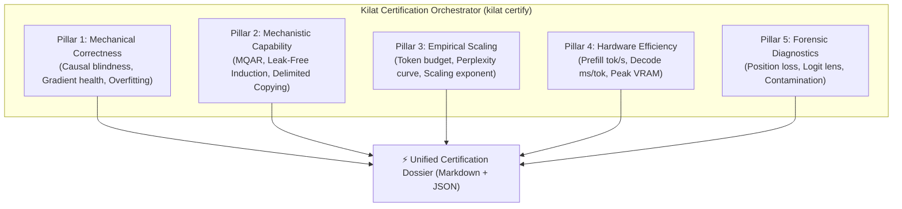

# 06 — Kilat Model Architecture Certification & Scaling Pipeline (KMCP)

> **Document Purpose**: Standardize empirical validation of the Kilat architecture, evolving it from isolated manual audits into a five-pillar **Unified Model Architecture Certification & Scaling Pipeline** aligned with frontier research standards (Zoology ICLR 2024, Mamba Appendix E.1, Meta Lingua, and DeepSeek-V3).

---

## 1. Five-Pillar Certification Architecture



---

## 2. Mathematical Specifications & Synthetic-Benchmark Bug Fixes

### A. Leak-Free Induction Heads
- **Previous flaw**: Target token $A$ was injected into `input_ids[second_pos + 1]`, allowing the model to copy the current input token without using an induction-head mechanism.
- **New specification**:
  - Sequence: `[..., S, A, ..., S, <QUERY>]`
  - At position `second_pos` (token $S$), the input token is $S$. The next position, `second_pos + 1`, contains a random marker/mask token `<QUERY>`.
  - Target $A$ is supervised exactly at the query position:
    $$\mathcal{L} = -\ln P(x_{\text{target}} = A \mid x_{\le \text{second\_pos}})$$
  - The model must fail when tested against an identity model with no memory (*negative test*).

### B. Delimited Selective Copying
- **Previous flaw**: There was no marker token, so a model without absolute positional embeddings could not know when to begin copying.
- **New specification**:
  - Alphabet: $\Sigma_{\text{noise}} = \{0\}$, $\Sigma_{\text{data}} = \{3 \dots K+2\}$, $\text{DELIMITER} = 1$, $\text{PAD} = 2$.
  - Input layout: `[d_1, 0, 0, d_2, 0, ..., DELIMITER, PAD, PAD, ...]`
  - Target layout: `[-100, ..., -100, d_1, d_2, ..., d_K]` immediately after `DELIMITER`.

### C. Zoology MQAR with Standard Causal Shifting
- Normalize model output consistently:
  $$\text{logits} = \text{out.logits if hasattr(out, 'logits') else out}$$
- Causal loss alignment:
  $$\text{logits}_{\text{shift}} = \text{logits}[:, :-1, :], \quad \text{labels}_{\text{shift}} = \text{labels}[:, 1:]$$

---

## 3. Module Structure & Implementation Plan

```
src/kilat/benchmarking/
├── __init__.py
├── registry.py           # Model registry (KilatTransformer & ReferenceAttention)
├── protocol.py           # Multi-seed reproducibility & aggregation
├── reporter.py           # Markdown & JSON dossier generator
├── tasks/
│   ├── __init__.py
│   ├── mqar.py           # Causal Zoology MQAR
│   ├── induction_heads.py# Leak-free induction heads
│   └── selective_copying.py # Delimited selective copying
├── pillars/
│   ├── __init__.py
│   ├── p1_correctness.py # Causal test, grad check, overfit 1 batch
│   ├── p2_capability.py  # MQAR, Induction, Copying sweep
│   ├── p3_scaling.py     # Compute-controlled budget & PPL scaling
│   ├── p4_efficiency.py  # Prefill, decode latency, peak VRAM
│   └── p5_diagnostics.py # Integrated position loss, logit lens, audit
└── harness.py            # Master certification orchestrator

tools/certify.py          # Unified CLI entrypoint
configs/certification/
├── smoke_test.yaml       # Fast laptop/CPU verification
└── frontier_full.yaml    # Production GPU sweep
```

---

## 4. Capability-Validation Findings (2026-11-12) & Protocol Improvements

### 4.1 Certification-Pipeline Bugs (Fixed)
| Pillar | Flaw | Fix |
| :--- | :--- | :--- |
| P3 | IID Zipf-distributed tokens with target `roll(x)` made context useless; the `ppl < 1000` pass threshold let an untrained model pass at V=256. | Interleave two realizations of a Markov chain (the next token depends on the token two positions back and is independent of the current token). Pass iff `gap_closed = (H_uni − NLL)/(H_uni − H_cond) ≥ 0.5`. A model without *mixing* gives `gap_closed ≈ 0` (FAIL); Kilat macro-synergy gives `0.91` (PASS). |
| P2 | The smoke threshold `0.05` was below chance accuracy; passing was evaluated only at the shortest context with one learning rate. | Require a pass at **every** context length; support `lrs` (best-of-LR, following the Zoology protocol); make `mqar_train_examples` configurable (default 20k). |

### 4.2 Root Cause: Initialization Scale in Narrow Models
- **Symptom**: `kilat-pure-attention` stalled at approximately `1/num_kv` accuracy on MQAR (the model identified the *set* of values but could not bind keys to values), while the reference Transformer reached 100%.
- **Diagnosis (two-way transplant ablation, sequence length 64 / 4 KV pairs)**: Kilat MLA attention inside a vanilla shell = **99.9%**; vanilla attention inside the Kilat shell = **26%**. RoPE (relative-invariance verified), RMSNorm, decoupled RoPE, weight tying, FFN, training duration, and learning rate were **ruled out**.
- **Decisive test**: Kilat shell + embedding std 1 (untied) = **99.3%**; vanilla model + embedding std 0.02 = **25.5%**.
- **Mechanism**: pre-norm `x₁ = e + Attn(norm(e))`; when `|e| ≪ |Attn|`, token identity is overwhelmed after layer 0. `N(0, 0.02)` is GPT-2's value for `n_embd=768`; at `n_embd=64`, embeddings are about 50× smaller than an O(1) stream.
- **Fix**: `KilatConfig.init_scheme="width_scaled"` (μP-style): Linear `1/√fan_in`, residual projections `/√(2L)`, `wte ~ N(0,1)`, and untied `lm_head ~ N(0, 1/n_embd)` (satisfying Gate 1: `|L₀ − ln V| ≤ 0.15`). The default config remains `"gpt2"` (preserving old checkpoints); canonical `kilat-*` presets use `width_scaled`. Regression guard: `tests/unit/models/test_init_scheme.py` (mini-MQAR: width_scaled ≥ 0.90, legacy ≤ 0.50).
- **Sequence length 128 / 8 KV pairs (d=64, 1500 steps) — not a bug**: `kilat-pure-attention` (width_scaled) reaches about 11% on seeds 0 and 1. The vanilla shell with the identical Kilat MLA attention reached 96% on seed 0 but **11.8% on seed 1** (stochastic MQAR phase transition), and a standard RoPE Transformer also fails (12.6%). Shell ablations (vanilla init, std `1/√(3·fan_in)`, GELU FFN) and an attribute-level diff of the attention modules show no structural difference. Only the absolute-position Transformer (99.95%) and **kilat-macro-synergy** (99.7%) pass reliably; the Global Decay layer appears to supply a local positional bias that makes the MQAR circuit easier to find. Implication: capability claims for pure MLA at longer contexts require multiple seeds and `d_model`/step sweeps (Zoology protocol), never a single run.

### 4.3 Validation Roadmap for Scalability and Transformer-Level Quality
1. **Mechanistic (low-cost)**: Zoology-style MQAR sweeps (sequence length/KV pairs × `d_model` ∈ {64…512}, best-of-LR, ≥3 seeds); MAD suite (Poli et al., ICML 2024); state tracking (parity, S5 composition — Merrill et al., ICML 2024); and length extrapolation.
2. **Language modeling**: compute-matched scaling across ≥4–5 model sizes versus a Transformer++ baseline (RoPE/SwiGLU/RMSNorm), tune LR per size, use μP/width-scaled initialization, fit `L(C) = A·C^−α + E`; measure position-wise loss; run zero-shot `lm-eval-harness` and recall-intensive tasks (FDA/SWDE, NIAH, RULER).
3. **Efficiency**: measure throughput and memory against context length; evaluate the Pareto frontier between *recall* and state size.
