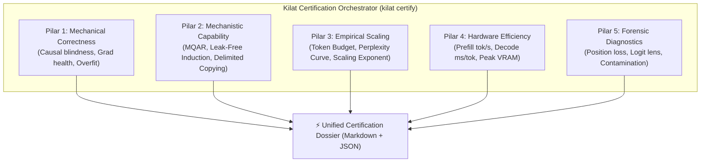

# 06 — Kilat Model Architecture Certification & Scaling Pipeline (KMCP)

> **Tujuan Dokumen**: Menstandarkan validasi empiris arsitektur Kilat dari sekadar audit manual satu per satu menjadi **Unified Model Architecture Certification & Scaling Pipeline** (5 Pilar) setara standar riset frontier (Zoology ICLR 2024, Mamba Appendix E.1, Meta Lingua, dan DeepSeek-V3).

---

## 1. Arsitektur 5 Pilar Sertifikasi



---

## 2. Spesifikasi Matematika & Perbaikan Bug Sintetis

### A. Induction Heads Bebas-Kebocoran (Leak-Free Induction)
- **Cacat Sebelumnya**: Target token $A$ di-inject ke `input_ids[second_pos + 1]`, memungkinkan model menyontek token input saat ini tanpa mekanisme induction head.
- **Spesifikasi Baru**:
  - Sequence: `[..., S, A, ..., S, <QUERY>]`
  - Pada posisi `second_pos` (token $S$), input token adalah $S$. Posisi berikutnya `second_pos + 1` diisi token penanda acak/masker `<QUERY>`.
  - Label target $A$ diawasi tepat pada posisi kemunculan query:
    $$\mathcal{L} = -\ln P(x_{\text{target}} = A \mid x_{\le \text{second\_pos}})$$
  - Model terbukti gagal jika model identitas (tanpa memori) diuji (*Negative Test*).

### B. Selective Copying dengan Delimiter Kausal (Delimited Selective Copying)
- **Cacat Sebelumnya**: Tidak ada token penanda; model tanpa absolute positional embedding tidak tahu kapan harus mulai menyalin.
- **Spesifikasi Baru**:
  - Alfabet: $\Sigma_{\text{noise}} = \{0\}$, $\Sigma_{\text{data}} = \{3 \dots K+2\}$, $\text{DELIMITER} = 1$, $\text{PAD} = 2$.
  - Layout input: `[d_1, 0, 0, d_2, 0, ..., DELIMITER, PAD, PAD, ...]`
  - Layout target: `[-100, ..., -100, d_1, d_2, ..., d_K]` tepat setelah `DELIMITER`.

### C. Zoology MQAR dengan Causal Shift Standar
- Output model selalu dinormalisasi:
  $$\text{logits} = \text{out.logits if hasattr(out, 'logits') else out}$$
- Penjajaran loss kausal:
  $$\text{logits}_{\text{shift}} = \text{logits}[:, :-1, :], \quad \text{labels}_{\text{shift}} = \text{labels}[:, 1:]$$

---

## 3. Struktur Modul & Rencana Implementasi

```
src/kilat/benchmarking/
├── __init__.py
├── registry.py           # Model registry (KilatTransformer & ReferenceAttention)
├── protocol.py           # Multi-seed reproducibility & aggregation
├── reporter.py           # Markdown & JSON dossier generator
├── tasks/
│   ├── __init__.py
│   ├── mqar.py           # Causal Zoology MQAR
│   ├── induction_heads.py# Leak-free induction heads
│   └── selective_copying.py # Delimited selective copying
├── pillars/
│   ├── __init__.py
│   ├── p1_correctness.py # Causal test, grad check, overfit 1 batch
│   ├── p2_capability.py  # MQAR, Induction, Copying sweep
│   ├── p3_scaling.py     # Compute-controlled budget & PPL scaling
│   ├── p4_efficiency.py  # Prefill, decode latency, peak VRAM
│   └── p5_diagnostics.py # Integrated position loss, logit lens, audit
└── harness.py            # Master certification orchestrator

tools/certify.py          # Unified CLI entrypoint
configs/certification/
├── smoke_test.yaml       # Fast laptop/CPU verification
└── frontier_full.yaml    # Production GPU sweep
```
