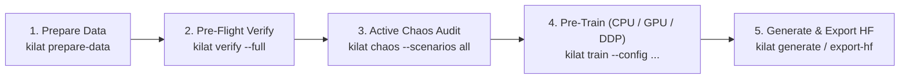

# Kilat Engineering, Mathematical Assurance, & Architecture Documentation (`v2.0.0`)

> **Status**: Production Architecture & Verification Reference (`v2.0.0`)  
> **Target Architecture**: Kernelized Lightweight Attention Transformer (`Kilat`) — Hybrid Global Decay + Latent MLA + Decoupled RoPE + DeepSeekMoE  
> **Design Paradigms**: `pytorch/torchtitan`, `facebookresearch/lingua`, `Lightning-AI/litgpt`, `allenai/OLMo-core`, `deepseek-ai/DeepSeek-V3`, Google DeepMind `Paxml`/`MaxText`

---

## 1. Philosophy: Why Kilat Enforces Numerical Assurance

In from-scratch LLM pre-training, the most destructive failures almost never raise a Python exception:
- A GPU kernel runs at full speed while an attention branch is silently detached from `autograd` (`grad_fn=None`).
- Training loss decreases smoothly, yet `weight_decay` erodes 1D decay horizons ($\lambda \to 0.5$) or Top-1 MoE routing zeroes out router gradients.
- Language perplexity (`PPL`) is inflated by `aux_loss`, the final partial gradient accumulation window is under-scaled, or multi-GPU DDP hangs on split-brain early stopping.

This `docs/` suite serves as the **Single Source of Truth** for both human researchers and AI coding agents operating on Kilat.

---

## 2. Documentation Map (`docs/` & `configs/`)

| Document | Core Scope & Responsibility | Related Agent Skills (`.agents/skills/core/`) |
| :--- | :--- | :--- |
| [`01_AGENT_ANTI_HALLUCINATION_CONTRACT.md`](./01_AGENT_ANTI_HALLUCINATION_CONTRACT.md) | Ground-truth `src/kilat/` module inventory (`v2.0.0`), non-`@dataclass` serialization rules, 12 forbidden agent hallucinations, and canonical public API contracts. | All 7 Core Skills |
| [`02_MATHEMATICAL_SPEC_AND_BUGFIX_PLAN.md`](./02_MATHEMATICAL_SPEC_AND_BUGFIX_PLAN.md) | Exact mathematical derivations, IEEE-754 FP16/BF16/FP32/FP64 precision bounds, and analytical backward equations (`M-01` .. `M-07`). | `pytorch-training`, `gpu-performance`, `assurance-chaos-engineering` |
| [`03_CODEBASE_RESTRUCTURE_PLAN.md`](./03_CODEBASE_RESTRUCTURE_PLAN.md) | Clean modular architecture (`models/`, `engine/`, `data/`, `inference/`, `distillation/`, `assurance/`, `configs/`, `utils/`, `cli.py`), single-source config & CLI overrides, zero-copy memmap pipeline, and DDP/checkpoint hardening. | `training-configuration`, `ml-data-engineering`, `checkpoint-reproducibility` |
| [`04_ASSURANCE_AND_CHAOS_ENGINEERING_PLAN.md`](./04_ASSURANCE_AND_CHAOS_ENGINEERING_PLAN.md) | **3-Layer Assurance Architecture**: `kilat verify` (Gates 1–6 & Stages 7–8), `kilat chaos` (`Saboteur` `C-01`–`C-08`), `FlightRecorderCallback`, and `assurance_report.{json,md}`. | `assurance-chaos-engineering`, `ml-testing` |
| [`05_STEP_BY_STEP_EXECUTION_CHECKLIST.md`](./05_STEP_BY_STEP_EXECUTION_CHECKLIST.md) | Engineering verification protocol, acceptance thresholds, and completed Phase 0–6 implementation sign-off checklist. | All 7 Core Skills |
| [`../configs/README.md`](../configs/README.md) | Tiered YAML presets (`debug_cpu.yaml`, `small_dense.yaml`, `small_moe.yaml`, `standard_moe.yaml`) and `--override` reference. | `training-configuration` |

---

## 3. Clean Repository Layout (`v2.0.0`)

```text
Kilat/
├── configs/                           # Ready-to-run tiered YAML configurations
│   ├── README.md                      # Preset guide & hyperparameter reference
│   ├── debug_cpu.yaml                 # Tier-0: <5s offline CPU verification & smoke training
│   ├── small_dense.yaml               # Tier-1: Single-GPU SwiGLU + Hybrid MLA/Decay + RoPE
│   ├── small_moe.yaml                 # Tier-2: Single-GPU DeepSeekMoE (bias_free) + Hybrid MLA
│   └── standard_moe.yaml              # Tier-3: Multi-GPU DDP 64-expert DeepSeekMoE
├── docs/                              # Architecture, Mathematical, & Assurance Specifications
├── src/kilat/
│   ├── __init__.py                    # Top-level public API exports (__version__ = "2.0.0")
│   ├── cli.py                         # Unified CLI: verify, chaos, train, prepare-data, generate, export-hf
│   ├── configs/                       # Validated configuration containers (MainConfig, KilatConfig, etc.)
│   ├── models/                        # Pure architecture primitives (KilatTransformer, Block, MLA, MoE, RoPE, Triton)
│   ├── engine/                        # Training loop, DDP context, atomic SHA-256 checkpointing, optimizers, schedulers
│   ├── data/                          # Datasets, zero-copy collator, dataloaders, tokenizers, memmap preprocessor
│   ├── inference/                     # TextGenerator, GenerationMixin, Samplers, LogitProcessors, HF exporter
│   ├── distillation/                  # Knowledge distillation losses (Vanilla, Reverse, Adaptive KD), Student, Teacher
│   ├── assurance/                     # 8-stage Pre-Training Verification Gates, Chaos Saboteur, FlightRecorder
│   └── utils/                         # BaseConfig, BaseModel, validators, parameter reports, CLI banner
└── tests/                             # 387 BDD unit, seam, pipeline, assurance, and chaos tests
```

---

## 4. End-to-End Engineering Workflow



---

## 5. Non-Negotiable Engineering Rules

1. **Numerical Proof Over Syntax**: Every architectural, data, or optimization change must pass `make check` (`0` ruff & mypy errors), `make test` ($\ge 80\%$ coverage, `0` warnings), `kilat verify --full`, and `kilat chaos --scenarios all` (`8/8` caught).
2. **No Legacy Folder Regression**: Historical duplicate directories (`arc/`, `training/`, `pipeline/`, `distiliation/`, `sample_config/`, `experiments/`) have been permanently retired. All new code belongs strictly in the canonical packages under `src/kilat/`.
3. **Zero-Sync Forward Pass**: Never introduce `.item()`, `.all()`, or `.any()` host-device synchronizations inside `nn.Module.forward()`.
4. **Git Discipline**: Run `make pre-commit` before committing; never execute `git push` automatically.
